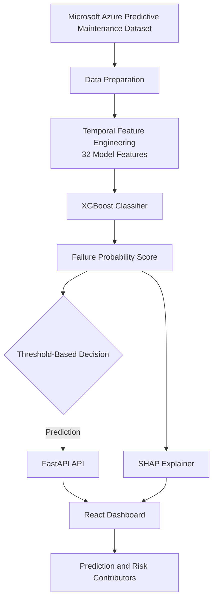
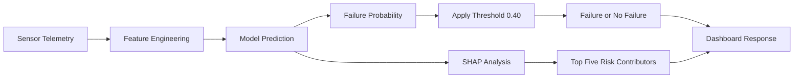

# Predictive Maintenance Engine

## AI-Powered Machine Failure Prediction & Explainability

An end-to-end machine learning system that predicts equipment failure within the next **24 hours** using multivariate sensor telemetry. The system is built with **XGBoost**, **Scikit-learn**, **SHAP**, **FastAPI**, and **React**.

## Key Highlights

- Processes **876K+ telemetry records** from the Microsoft Azure Predictive Maintenance dataset.
- Uses **32 engineered features** covering sensor readings, rolling statistics, temporal patterns, and sensor changes.
- Achieves **96.14% ROC-AUC** with the XGBoost classifier.
- Achieves **71.04% failure recall** at a tuned decision threshold of **0.40**.
- Provides SHAP-based explainability to identify the **top five features** contributing to individual predictions.
- Includes an interactive React dashboard connected to a FastAPI prediction API

## Model Performance

The dataset contains a highly imbalanced target, with approximately **1.96% positive failure cases**. Therefore, evaluation focuses on ROC-AUC, recall, precision, and F1-score rather than accuracy alone.

| Metric | Result |
| --- | ---: |
| **ROC-AUC** | **96.14%** |
| **Recall** | **71.04%** |
| **Precision** | **20.45%** |
| **F1-Score** | **31.75%** |
| **Accuracy** | **94.52%** |
| **Decision Threshold** | **0.40** |

### Why These Metrics Matter

- **Recall** measures the proportion of actual failures detected by the model.
- **Precision** indicates how many predicted failures were genuine failures.
- The **decision threshold** controls the trade-off between detecting more failures and generating more false alarms.

## Features

### 1. Predictive Machine Learning

- Predicts whether a machine will experience a failure within the next **24 hours**.
- Uses **XGBoost** to learn patterns from multivariate telemetry.
- Evaluates performance on a chronological holdout set.
- Uses a configurable decision threshold to classify failure risk.

### 2. Temporal Feature Engineering

The model uses **32 features** derived from four sensor measurements:

- **Voltage** (`volt`)
- **Rotation** (`rotate`)
- **Pressure** (`pressure`)
- **Vibration** (`vibration`)

Engineered features include:

- Current sensor readings.
- Time-based features such as hour, day, month, and day of the week.
- Six-hour rolling means and standard deviations.
- Twenty-four-hour rolling means and standard deviations.
- One-hour and twenty-four-hour sensor changes.

Rolling features capture changes in machine behavior over time, helping the model identify potentially abnormal operating patterns.

### 3. Explainable AI with SHAP

**SHAP** (*SHapley Additive exPlanations*) helps interpret individual model predictions.

The explainability module provides:

- Global feature importance.
- SHAP summary and beeswarm visualizations.
- Individual prediction explanations using waterfall plots.
- API responses containing the top five contributing features and whether they increase or decrease the model's predicted failure risk.

### 4. FastAPI Backend

The trained model is exposed through REST API endpoints.

| Endpoint | Method | Purpose |
| --- | --- | --- |
| `/` | `GET` | API health check and model information |
| `/predict` | `POST` | Returns failure probability and prediction |
| `/explain` | `POST` | Returns the prediction and top SHAP contributors |
| `/docs` | `GET` | Opens the interactive Swagger API documentation |

### 5. React Dashboard

The frontend provides an interactive machine-health monitoring interface featuring:

- Editable sensor readings.
- Failure probability and predicted machine status.
- Model decision threshold.
- SHAP-based feature explanations.
- API integration through asynchronous HTTP requests.

## System Architecture



### Prediction and Explainability Flow



## Technology Stack

| Category | Technologies |
| --- | --- |
| **Language** | Python, JavaScript |
| **Data Processing** | Pandas, NumPy |
| **Machine Learning** | Scikit-learn, XGBoost |
| **Explainable AI** | SHAP |
| **Backend** | FastAPI, Uvicorn |
| **Frontend** | React, Vite, CSS |
| **Visualization** | Matplotlib |
| **Model Persistence** | Joblib |
| **Version Control** | Git, GitHub |

## Dataset

The project uses the **Microsoft Azure Predictive Maintenance Dataset**, which contains machine telemetry and maintenance-related information.

The original dataset includes:

- `PdM_telemetry.csv` — sensor readings collected over time.
- `PdM_errors.csv` — machine error events.
- `PdM_failures.csv` — recorded component failures.
- `PdM_maint.csv` — maintenance records.
- `PdM_machines.csv` — machine metadata.

The modeling dataset contains **876,100 telemetry observations**. The prediction target is `failure_next_24h`, indicating whether a recorded failure occurs within the next 24 hours after a telemetry observation.

The target is constructed using failure timestamps. Target-construction columns such as `failure_time` and `hours_to_failure` are excluded from model inputs to prevent target leakage.

## Project Structure

```text
predictive-maintenance/
├── frontend/
│   ├── src/
│   │   ├── App.jsx
│   │   └── App.css
│   ├── package.json
│   └── ...
├── models/
│   ├── model.pkl
│   ├── feature_names.json
│   └── threshold.json
├── notebooks/
│   └── saved_model_original/
│       ├── X_test.pkl
│       └── y_test.pkl
├── shap_explainability/
│   ├── shap_feature_importance.png
│   ├── shap_summary.png
│   └── shap_waterfall.png
├── src/
│   ├── app.py
│   ├── explain.py
│   ├── evaluate.py
│   ├── predict.py
│   ├── feature_engineering.py
│   └── utils.py
├── requirements.txt
└── README.md
```

> **Note:** The structure lists the principal project files. Dataset files and other local artifacts may be excluded from version control.

## Getting Started

### Prerequisites

- **Python 3.12**
- **Node.js and npm**
- **Git**

### 1. Clone the Repository

```bash
git clone https://github.com/saumyadhorje/predictive-maintenance.git
cd predictive-maintenance
```

### 2. Set Up the Python Environment

```powershell
python -m venv venv
.\venv\Scripts\Activate.ps1
python -m pip install -r requirements.txt
```

### 3. Start the FastAPI Backend

From the project root, run:

```bash
python -m uvicorn src.app:app --reload
```

The API will be available at:

- **API:** `http://127.0.0.1:8000`
- **Interactive documentation:** `http://127.0.0.1:8000/docs`

### 4. Start the React Frontend

Open a second terminal:

```bash
cd frontend
npm install
npm run dev
```

Open the local URL printed by Vite, usually:

```text
http://localhost:5173
```

Keep both the backend and frontend running while using the dashboard.

## Using the API

### Predict Machine Failure

Send a `POST` request to `/predict` with the model's **32 required input features**.

Example using Python:

```python
import requests

payload = {
    # Supply all 32 features expected by the model.
    # Include current readings, temporal features,
    # rolling statistics, and sensor-change features.
}

response = requests.post(
    "http://127.0.0.1:8000/predict",
    json=payload,
)

print(response.json())
```

A successful prediction returns a failure probability, the configured threshold, and a classification such as `FAILURE` or `NO FAILURE`.

### Explain a Prediction

Send the same **32-feature payload** to `/explain`. The response includes the predicted failure probability and the **top five SHAP contributors**, including the direction of their impact on the model output.

Use the interactive `/docs` page to inspect the request schemas and test either endpoint.

## Model Evaluation Notes

- The positive failure class represents approximately **1.96%** of telemetry observations.
- Accuracy alone can be misleading on such an imbalanced dataset.
- Recall is important because missed failures can lead to unexpected downtime.
- Precision matters because false alarms can trigger unnecessary inspections or maintenance.
- Threshold selection represents a trade-off between detecting failures and generating false positives.
- SHAP explains the model's output; it does not establish that a sensor feature causes a machine failure.

## Limitations

- The model estimates failure risk from historical data and is not a guarantee of future machine behavior.
- The current dashboard uses sample engineered values for the temporal features; changing a raw sensor value does not automatically recompute all 32 features from historical telemetry.
- The system currently demonstrates a local API and dashboard workflow rather than a production industrial monitoring deployment.
- The decision threshold should be selected according to operational costs and validated on representative, unseen data before deployment.

## Future Improvements

- Build an inference-time feature engineering pipeline from incoming sensor streams.
- Integrate live telemetry ingestion and persistent historical storage.
- Add machine-level risk trends, alert history, and maintenance scheduling.
- Containerize the application with Docker.
- Deploy the API and frontend to a cloud environment.
- Evaluate additional models and calibrate probabilities against real operational requirements.

## Author

**Saumya Dhorje**  
GitHub: [@saumyadhorje](https://github.com/saumyadhorje)

---

Built to explore **predictive maintenance**, **imbalanced classification**, **temporal feature engineering**, **model evaluation**, and **explainable machine learning**.
